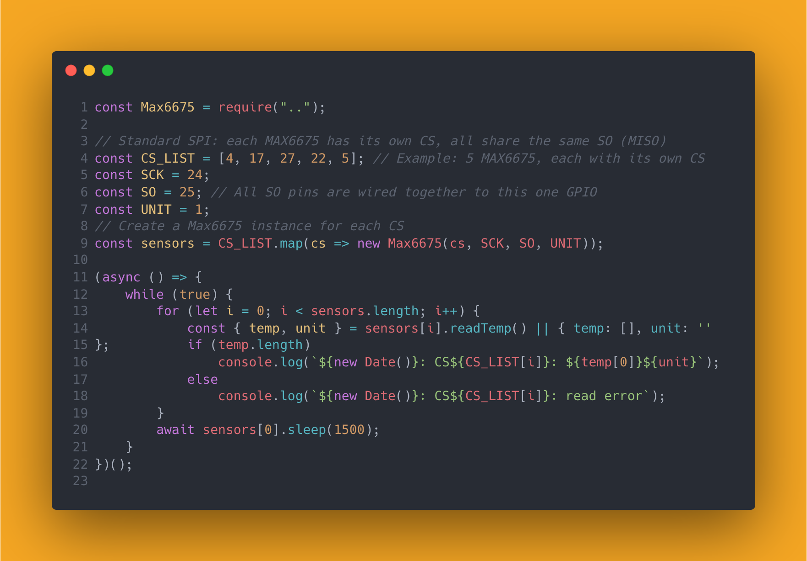

# Max6675

[](https://www.npmjs.com/package/max6675-raspi) [](README.md)

在树莓派上使用 Node.js 驱动 Max6675 芯片，读取 K 型热偶的温度值。

```sh
npm i max6675-raspi --save
```



## API

### `Max6675`

```js
const Max6675 = require("max6675-raspi");
const CS = 4;
const SCK = 24;
const SO = 25; // 只支持单个 SO 引脚，所有 MAX6675 的 SO 并联到此 GPIO
const UNIT = 1;

const max6675 = new Max6675(CS, SCK, SO, UNIT);
```

构造函数参数说明：

- `CS`：Max6675 模块的 `CS` 脚对应的树莓派 GPIO 号。
- `SCK`：Max6675 模块的 `SCK` 脚对应的树莓派 GPIO 号。
- `SO`：Max6675 模块的 `SO` 脚对应的树莓派 GPIO 号，只能为单个整数（所有 MAX6675 的 SO 并联到此 GPIO）。
- `UNIT`：设置结果输出单位，`1` 为 `°C`，`2` 为 `°F`，不传参数则默认值为 `1`，传其他值则直接返回 Max6675 芯片的二进制数转十进制数值。

### `setPin`

```js
const Max6675 = require("max6675-raspi");

const CS = 4;
const SCK = 24;
const SO = 25;
const UNIT = 1;

// const max = new Max6675(CS, SCK, SO, UNIT);
const max6675 = new Max6675();
max6675.setPin(CS, SCK, SO, UNIT);
```

如果你在 `new Max6675()` 的时候没有传参数，可以调用此方法设置针脚信息。参数与构造函数一致。

### `readTemp`

在设定了`CS`，`SCK`，`SO`和`UNIT`（默认值为`1`） 后，即能调用这个方法来获取值。

```js
const Max6675 = require("max6675-raspi");

const CS = 4;
const SCK = 24;
const SO = 25;
const UNIT = 1;
const max6675 = new Max6675();
max6675.setPin(CS, SCK, SO, UNIT);
const { temp, unit } = max6675.readTemp();
console.log(`${new Date()}:${temp.map((item) => item + unit)}`);
```

`setPin`之后也可以立即调用`readTemp`

```js
const Max6675 = require("max6675-raspi");

const CS = 4;
const SCK = 24;
const SO = 25;
const UNIT = 1;
const max6675 = new Max6675();
const { temp, unit } = max6675.setPin(CS, SCK, SO, UNIT).readTemp();
console.log(`${new Date()}:${temp.map((item) => item + unit)}`);
```

### `sleep`

这是一个基于 Promise 的延时器，适合在异步循环中使用。例如：

```js
const Max6675 = require("max6675-raspi");
const max6675 = new Max6675(4, 24, 25, 1);

async function main() {
    while (true) {
        const { temp, unit } = max6675.readTemp();
        console.log(`${new Date()}: ${temp[0]}${unit}`);
        await max6675.sleep(1500);
    }
}
main();
```

## 多通道推荐用法

```js
const Max6675 = require("max6675-raspi");
// 标准 SPI：每个 Max6675 都有自己的 CS，所有人共享相同的 SO（MISO）
const CS_LIST = [4, 17, 27, 22, 5]; // 示例：5 个 Max6675，每个有独立 CS
const SCK = 24;
const SO = 25; // 所有 SO 并联到这个 GPIO
const UNIT = 1;
const sensors = CS_LIST.map(cs => new Max6675(cs, SCK, SO, UNIT));

async function main() {
    while (true) {
        for (let i = 0; i < sensors.length; i++) {
            const { temp, unit } = sensors[i].readTemp() || { temp: [], unit: '' };
            if (temp.length)
                console.log(`${new Date()}: CS${CS_LIST[i]}: ${temp[0]}${unit}`);
            else
                console.log(`${new Date()}: CS${CS_LIST[i]}: read error`);
        }
        await sensors[0].sleep(1500);
    }
}
main();
```

## GPIO

注意：SO 只支持单个 GPIO，所有 MAX6675 的 SO 引脚应物理并联到同一个树莓派 GPIO。
每个 MAX6675 需独立 CS。

这里特地提 GPIO，`SO`，`CS`，`SCK`的值，是树莓派上的 BCM GPIO（绿色），不是针脚号。

引用一张 [`https://github.com/splitbrain/rpibplusleaf`](https://github.com/splitbrain/rpibplusleaf) 的图片。

[](https://github.com/splitbrain/rpibplusleaf)
