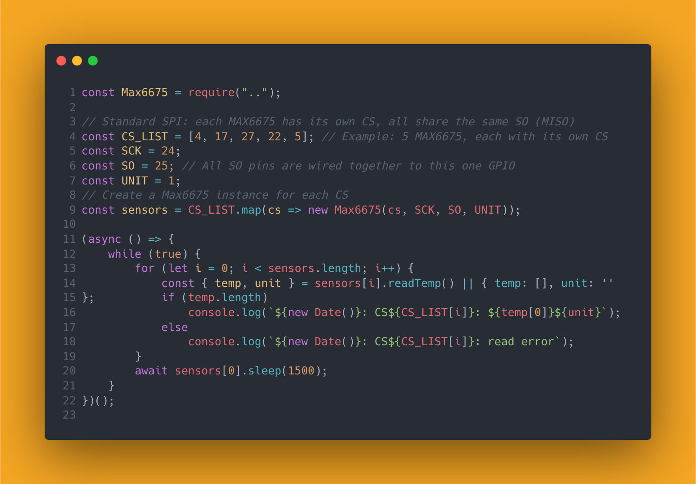

# Max6675

[](https://www.npmjs.com/package/max6675-raspi) [](README.cn.md)

Use Node.js on Raspberry Pi to drive the Max6675 chip and read the temperature from a K-type thermocouple.

```sh
npm i max6675-raspi --save
```



## API

### `Max6675`

```js
const Max6675 = require("max6675-raspi");
const CS = 4;
const SCK = 24;
const SO = 25; // Only a single SO pin is supported, all MAX6675 SOs should be wired together to this GPIO
const UNIT = 1;

const max6675 = new Max6675(CS, SCK, SO, UNIT);
```

Constructor parameters:

- `CS`: The GPIO number for the CS pin of the MAX6675 module.
- `SCK`: The GPIO number for the SCK pin of the MAX6675 module.
- `SO`: The GPIO number for the SO pin of the MAX6675 module. Only a single integer is allowed (all MAX6675 SOs should be wired together to this GPIO).
- `UNIT`: Output unit, `1` for `°C`, `2` for `°F`. Default is `1`. Any other value returns the raw decimal value from the MAX6675 chip.

### `setPin`

```js
const Max6675 = require("max6675-raspi");

const CS = 4;
const SCK = 24;
const SO = 25;
const UNIT = 1;

// const max = new Max6675(CS, SCK, SO, UNIT);
const max6675 = new Max6675();
max6675.setPin(CS, SCK, SO, UNIT);
```

If you didn't pass parameters to `new Max6675()`, you can use this method to set the pin configuration. The parameters are the same as the constructor.

### `readTemp`

After setting `CS`, `SCK`, `SO`, and `UNIT` (default is `1`), you can call this method to get the value.

```js
const Max6675 = require("max6675-raspi");

const CS = 4;
const SCK = 24;
const SO = 25;
const UNIT = 1;
const max6675 = new Max6675();
max6675.setPin(CS, SCK, SO, UNIT);
const { temp, unit } = max6675.readTemp();
console.log(`${new Date()}:${temp.map((item) => item + unit)}`);
```

You can also call `readTemp` immediately after `setPin`:

```js
const Max6675 = require("max6675-raspi");

const CS = 4;
const SCK = 24;
const SO = 25;
const UNIT = 1;
const max6675 = new Max6675();
const { temp, unit } = max6675.setPin(CS, SCK, SO, UNIT).readTemp();
console.log(`${new Date()}:${temp.map((item) => item + unit)}`);
```

### `sleep`

This is a Promise-based delay function, suitable for use in async loops. For example:

```js
const Max6675 = require("max6675-raspi");
const max6675 = new Max6675(4, 24, 25, 1);

async function main() {
    while (true) {
        const { temp, unit } = max6675.readTemp();
        console.log(`${new Date()}: ${temp[0]}${unit}`);
        await max6675.sleep(1500);
    }
}
main();
```

## Recommended Multi-Channel Usage

```js
const Max6675 = require("max6675-raspi");
// Standard SPI: each MAX6675 has its own CS, all share the same SO (MISO)
const CS_LIST = [4, 17, 27, 22, 5]; // Example: 5 MAX6675, each with its own CS
const SCK = 24;
const SO = 25; // All SO pins are wired together to this one GPIO
const UNIT = 1;
const sensors = CS_LIST.map(cs => new Max6675(cs, SCK, SO, UNIT));

async function main() {
    while (true) {
        for (let i = 0; i < sensors.length; i++) {
            const { temp, unit } = sensors[i].readTemp() || { temp: [], unit: '' };
            if (temp.length)
                console.log(`${new Date()}: CS${CS_LIST[i]}: ${temp[0]}${unit}`);
            else
                console.log(`${new Date()}: CS${CS_LIST[i]}: read error`);
        }
        await sensors[0].sleep(1500);
    }
}
main();
```

## GPIO

Note: Only a single SO (MISO) GPIO is supported. All MAX6675 SO pins should be physically connected (wired-OR) to the same Raspberry Pi GPIO. Each MAX6675 must have its own CS pin.

All pin numbers (`SO`, `CS`, `SCK`) refer to the BCM GPIO numbers (green) on the Raspberry Pi, not the physical pin numbers.

Reference image from [`https://github.com/splitbrain/rpibplusleaf`](https://github.com/splitbrain/rpibplusleaf):

[](https://github.com/splitbrain/rpibplusleaf)
